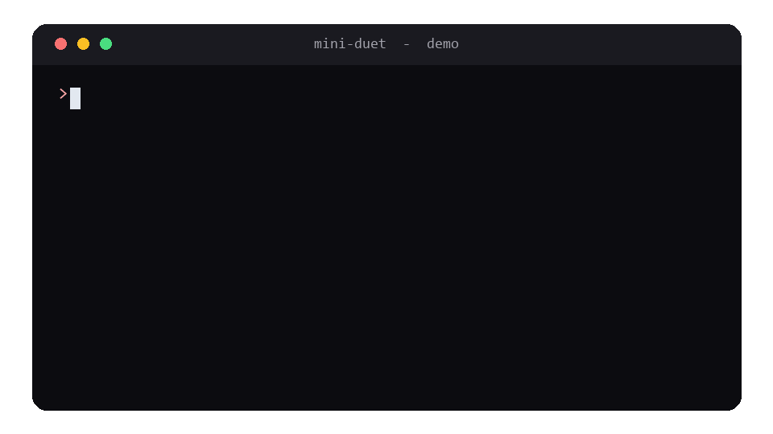

# Mini Duet

[](https://github.com/Zubair-hussain/Mime_Duet/actions/workflows/ci.yml)
[](https://github.com/Zubair-hussain/Mime_Duet/actions/workflows/deploy.yml)


**Build your own small, proactive AI assistant with Claude Opus 5.5, running on your own computer.**

Mini Duet checks an inbox on a schedule, writes you a short brief of what needs your attention, drafts replies, and **asks for your approval before it sends anything**.

> **Note:** This is **not** Anthropic's official Claude Duet app. Claude Duet is Anthropic's own product and it has no public API. Mini Duet is a small do-it-yourself version that talks to Claude through the [Anthropic API](https://docs.claude.com).

## Demo



*A sample run with the demo inbox. This GIF is an illustration, drawn by `scripts/make_demo_gif.py`.*

## Live site

A one-page site for this project lives in [`docs/`](docs/) and deploys to GitHub Pages. See [Deploy the website](#deploy-the-website) for the steps. Once Pages is on, it is live at **https://zubair-hussain.github.io/Mime_Duet/**.

## The fastest way: let an AI build it for you

You do not have to write any code. Give this README to **Claude** or **Codex** and say:

> "Build this project for me on my computer, following the README step by step."

It will create the files, set up the virtual environment and install the packages.

**The one step you must do yourself is getting your API key** (Step 1). No AI can do that for you.

## What you need

- A computer or laptop (Windows, macOS or Linux)
- [Python 3.10 or newer](https://www.python.org/downloads/)
- [Visual Studio Code](https://code.visualstudio.com/) with the **Python** extension
- An Anthropic Console account and an API key

## Step 1: Get your API key (you do this yourself)

1. Go to **[console.anthropic.com](https://console.anthropic.com)** and sign in.
2. Open **Billing** and add a small amount of credit.
3. Open **API keys** and click **Create key**. Give it a name.
4. **Copy the key now.** You will not be able to see it again. Keep it somewhere safe.

Never share your key, and never paste it into your code.

## Step 2: Get the code and set up the project

Download the project and open it in VS Code:

```bash
git clone https://github.com/Zubair-hussain/Mime_Duet.git
cd Mime_Duet
code .
```

Then open the terminal (**Ctrl + `**).

Create a virtual environment and turn it on:

```bash
python -m venv .venv
```

Windows:

```bash
.venv\Scripts\activate
```

macOS / Linux:

```bash
source .venv/bin/activate
```

Install the packages:

```bash
pip install -r requirements.txt
```

## Step 3: Set your API key

Store the key in an **environment variable**, so it never ends up in your code or on GitHub.

Windows (PowerShell):

```powershell
$env:ANTHROPIC_API_KEY = "your-key-here"
```

macOS / Linux:

```bash
export ANTHROPIC_API_KEY="your-key-here"
```

This lasts for the current terminal only. Set it again if you open a new one.

## Step 4: Run it

```bash
python -m duet --once
```

Mini Duet reads the inbox, drafts a reply, and asks:

```
Mini Duet wants to send to Sara (client):
  Hi Sara! Yes, invoice #42 went out this morning.
Approve? (y/n)
```

Type `y` to send it or `n` to decline. Then it prints your brief.

Leave off `--once` and it checks in again every 3 hours. Press **Ctrl + C** to stop it.

The single-file version from the video still works exactly as shown:

```bash
python mini_duet.py
```

